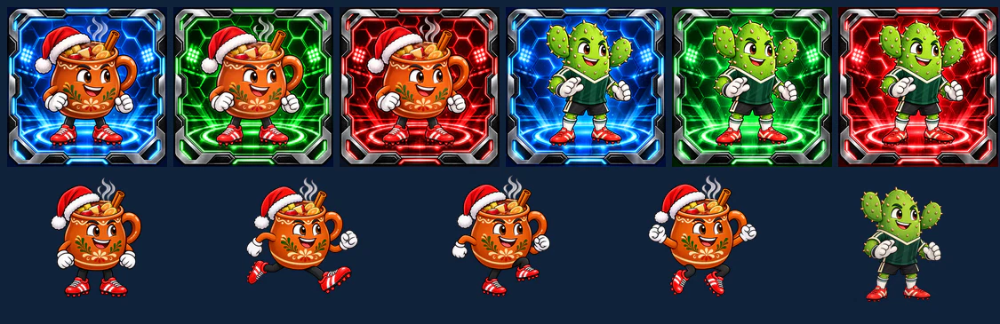

# Don Ponchito — ponche navideño mexicano

Issue #36. ID estable: `ponche_navideno`. Ponche de frutas **sin alcohol** en
jarrito de barro, con guayaba/manzana, canela, gorro navideño, guantes blancos y
botines rojos. Historia, nombre y descripción de wallpaper en español e inglés.

## Paquete publicado

| Uso | Archivos | Dimensiones |
| --- | --- | --- |
| Juego | idle, run_1, run_2, jump | 512 × 341 con alfa |
| Selección | selection_default, selection_player, selection_cpu | 512 × 512 |
| Álbum | club | 512 × 768 |

Los ocho WebP suman 541,688 bytes. La revisión del catálogo se incrementa a
`2026-11-17.1`; bytes y SHA-256 se calculan sobre los archivos finales. El álbum
conserva el precio de 140 monedas de los otros personajes mexicanos. La escala
visual es 0.48: se comparó la silueta corporal con Nopalín a 0.44 para compensar
el margen de vapor. No cambia colisiones, velocidad ni física. Lienzo de sprites
centrado y línea de apoyo a 321; altura de alfa normalizada a 300 píxeles.

Disponible en `free_play`, `tournament` y `album`. Se añade al pool de Mexican
Food sin retirar personajes ni tocar Fast Food: el cliente elige el jugador y
siete rivales entre nueve elegibles. Las partidas guardadas conservan su snapshot.
Compatible con el contrato remoto existente desde 1.0.11; no necesita AAB nuevo.
La publicación depende de revisión, merge y deploy correcto de Pages.

## Arte y procedencia

Se usó la herramienta integrada `image_gen`, una generación por asset/variante.
Referencias de estilo: las tres selecciones aprobadas de Nopalín en
`foodball-go/docs/art/reference/selection_{default,player,cpu}.webp` y el sprite
local Soda para contorno y lectura de juego. No se usó CLI/API ni placeholders.

Prompts utilizados (normalizados):

- Normal: "Square Foodball Go selection card. Reference is STYLE ONLY: exact
  angular silver metallic frame, cyan inner light, saturated hexagon stadium,
  side floodlights and circular platform. New cheerful terracotta jarrito mug,
  right handle, amber alcohol-free fruit punch with guava/apple and cinnamon,
  steam, Santa cap, expressive eyes/smile, white gloves, short black legs and
  red football boots. Full body 75–80%, polished 2D cartoon, no text or logo."
- Jugador/CPU: "Change ONLY environmental cyan lighting to emerald green / ruby
  red. Keep geometry, mascot face, pose, size, terracotta mug, hat, gloves and
  red boots unchanged. Keep silver frame silver; do not tint the character."
- Idle: "Exact identity from normal card; single relaxed standing gameplay
  sprite, white gloves at sides, same baseline. Clean simplified shading and
  dark outline readable at 130px. Genuine transparency including handle
  opening; no floor, shadow, ball, frame or text."
- Run 1: "Exact identity from idle. Change ONLY pose: long stride, left boot
  forward/right extended back, arms opposing; running screen right."
- Run 2: "Exact identity from idle. Change ONLY pose: compact second stride,
  right knee lifted, left foot under body, arms pumping; visibly distinct."
- Jump: "Exact identity from idle. Change ONLY pose: both knees bent, boots
  lifted and arms raised outward. Same transparent sprite constraints."
- Club: "Vertical 2:3 wallpaper, exact ponche identity, full body and soccer
  ball on pitch in a Mexican posada stadium at night, distant papel picado,
  star piñata and Christmas lights; ornate gold frame with green/red accents.
  Polished colorful 2D cartoon, no words, letters, numbers or watermark."

Postproceso mecánico con Godot 4.3: encuadre/alineación de alfa, redimensionado
Lanczos y compresión WebP con calidad 0.86; sin redibujar caras o inventar poses.
Los originales permanecen fuera de Git; el catálogo referencia solo estos WebP.

## Revisión y pruebas

Arriba: Ponchito normal/jugador/CPU y referencias Nopalín normal/jugador/CPU.
Abajo: sus cuatro poses y Nopalín, a sus respectivas escalas de cliente y con
línea de apoyo comparable. Es una lámina de revisión, no una captura de partida.
Se inspeccionaron identidad, encuadre completo, poses, alfa y lectura a tamaño
móvil; no se afirma playtest físico Android.

- `python scripts/validate_catalog.py`: integridad, presupuesto, copas y metadatos.
- `python scripts/validate_liveops.py`: regresión del manifiesto vigente.
- `python -m unittest discover -s scripts -p 'test_*.py'`: incluye paquete Ponchito,
  alfa, poses distintas, dimensiones, textos, precio y pertenencia a la copa.
- Cargador de producción de Foodball Go (base `4fcd6a6`): se sustituyó únicamente
  el transporte HTTP por los mismos archivos locales, con caché de prueba
  aislada. Activó 16 personajes (8 locales + 8 remotos), Ponchito visible en los
  tres contextos y snapshot Mexican Food de ocho con Ponchito seleccionado.

Revisión humana, publicación de Pages y prueba real en Android pendientes.
