# Selecciones unificadas del roster integrado

Issue de Site: #32. Soporte del cliente: FerFranky/foodball-go#259.
Revisión: `2026-10-26.3`. Se publican 24 WebP cuadrados de 512×512,
2,140,854 bytes en total, mediante `character_overrides.<id>.selection_assets`.

| Personaje | Normal | Jugador | CPU |
| --- | --- | --- | --- |
| Burger | 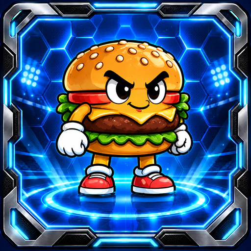 | 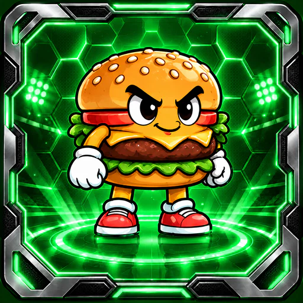 | 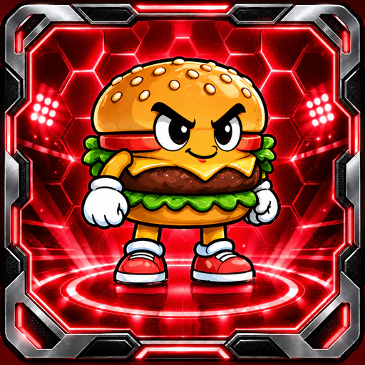 |
| Pizza | 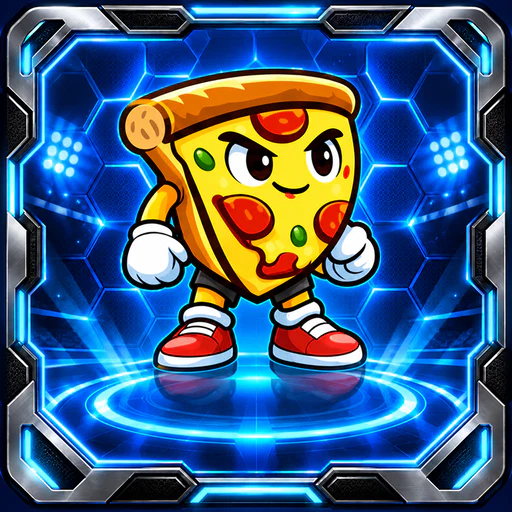 | 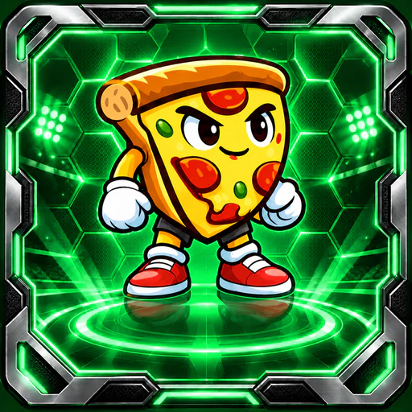 | 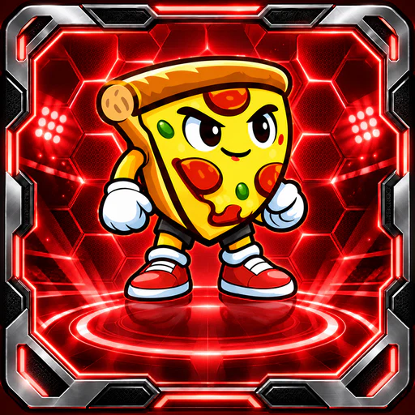 |
| Fries | 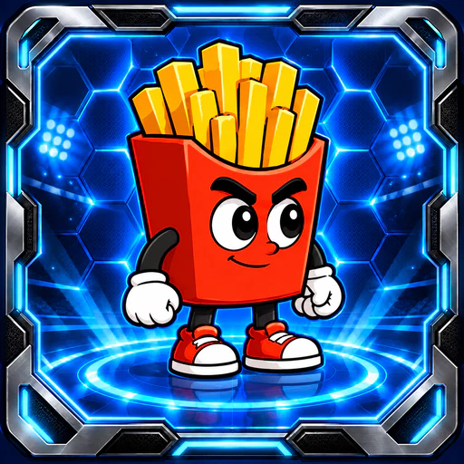 | 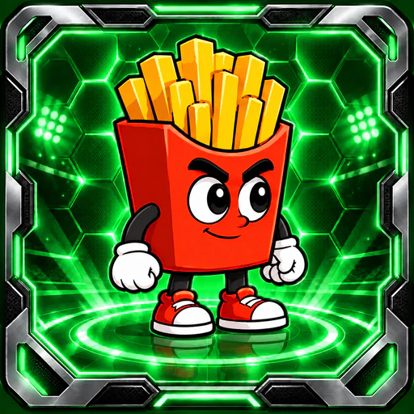 | 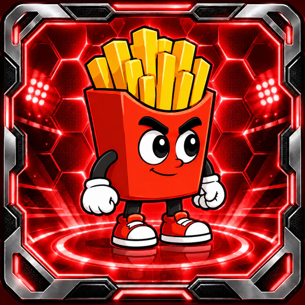 |
| Taco | 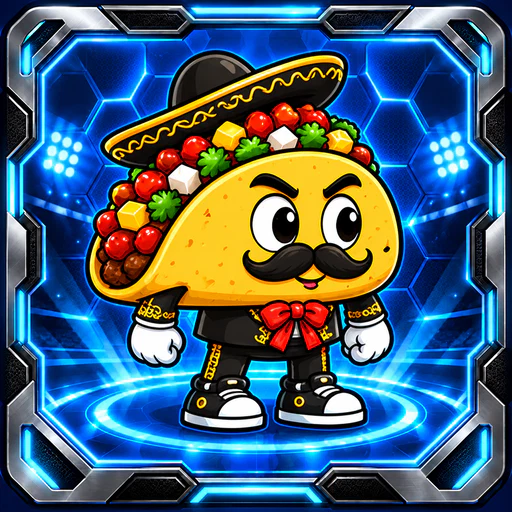 | 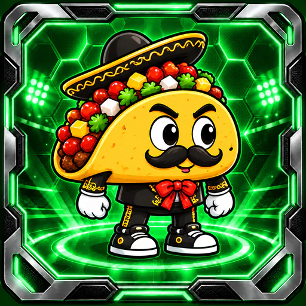 | 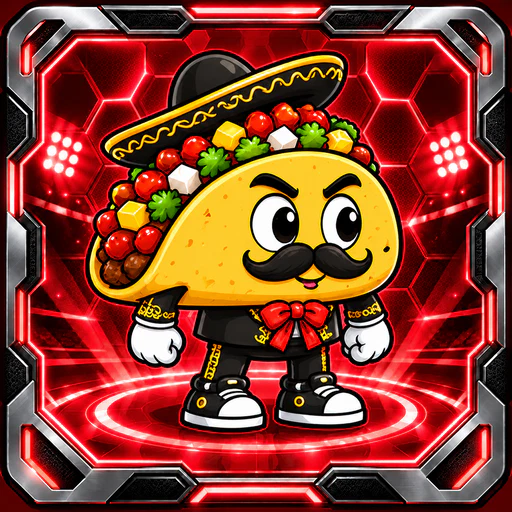 |
| Hotdog | 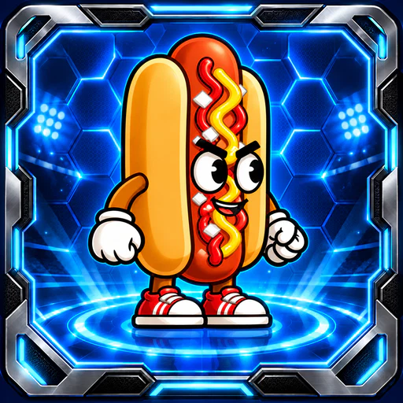 | 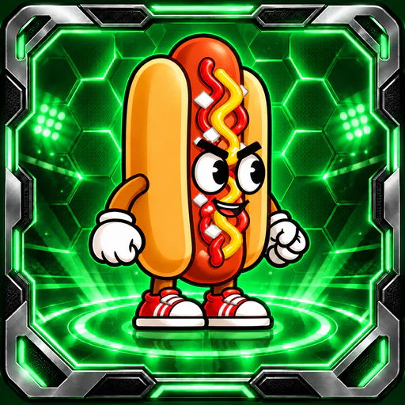 | 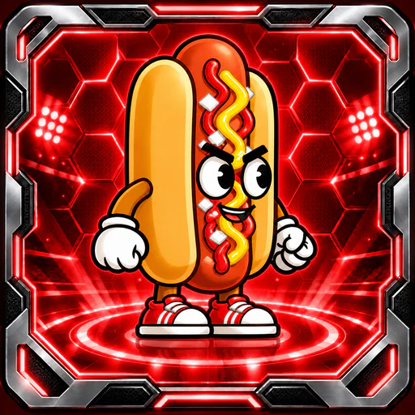 |
| Icecream |  |  |  |
| Nacho | 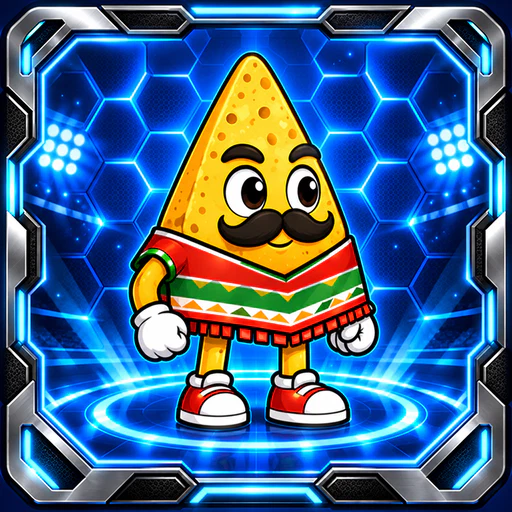 | 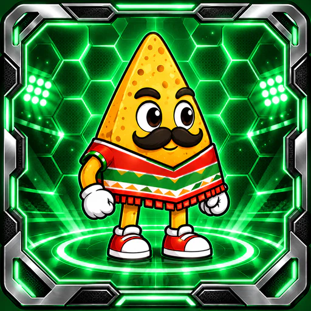 | 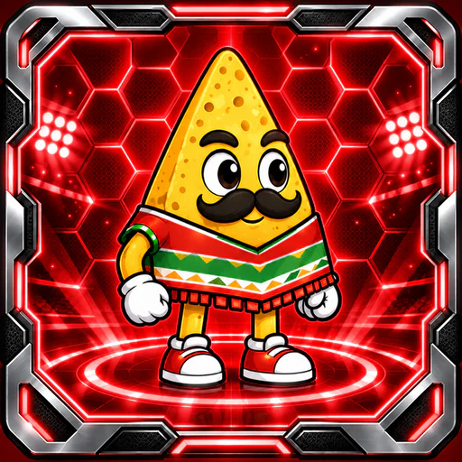 |
| Soda | 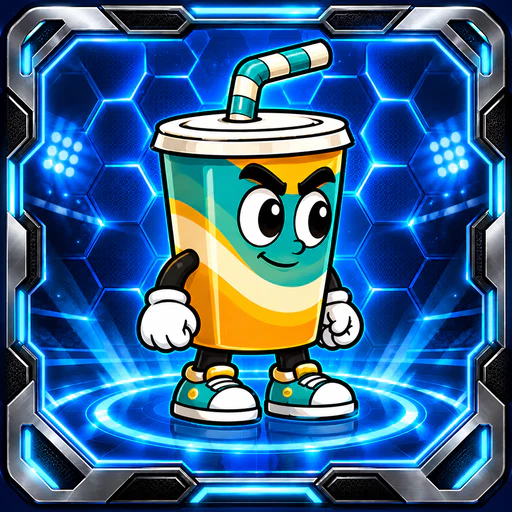 | 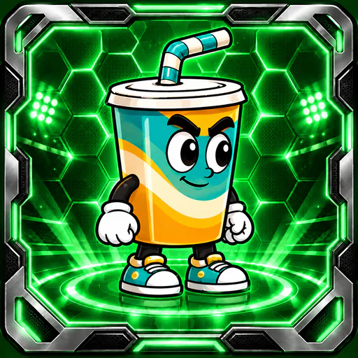 | 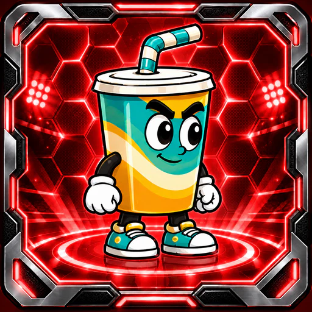 |

## Dirección y generación

Se usó la herramienta integrada de generación de imágenes. Para cada tarjeta
normal se inspeccionó como referencia de identidad la selección original del
repositorio del juego y como referencia de estilo `nopal_selection_default.webp`.
El fondo, marco y plataforma siguen los de los nuevos; se conservan comida,
rostro, expresión, guantes, calzado y accesorios de los originales.

Prompt base: “Foodball Go square character-selection card. Input 1 is edit
target and identity reference: preserve the mascot's face, expression, food
shape, silhouette, pose, gloves, shoes, accessories and clothing colors.
Do not redesign or humanize it, add a jersey or change its face. Input 2 is
style reference for the environment only: same angular silver metallic border,
saturated luminous cyan blue hexagonal stadium background, bright floodlights
and circular blue platform. Full body inside border, head and feet clear of
edges, character centered around 78% canvas height. Polished 2D cartoon.
Square full bleed, no text, labels, numbers, logos or watermark.”

Prompt de variantes: “Preserve exactly character identity, face, expression,
pose, proportions, food colors, costume, shoes, accessories, silver outer
frame, composition and geometry. Change only the environmental illumination
of hexagons, glowing inner border, floodlights and circular platform to
saturated emerald green for PLAYER / ruby red for CPU. Character colors
remain unchanged. Square image, no text, numbers or extra elements.”

Los outputs se optimizaron a WebP sin modificar el diseño. Se revisaron los
originales, las variantes y muestras de la entrega reducida. El contrato visual
del juego y su agente de dirección se incorporan junto al soporte del cliente.

## Compatibilidad y verificación

Los clientes anteriores ignoran `selection_assets` y siguen usando imágenes
integradas. Es necesario instalar el siguiente AAB con soporte remoto para
ver este cambio; los posteriores ajustes de estas tarjetas llegarán desde Site.
No se cambian políticas de disponibilidad, escalas, historias, álbum ni copas.

Validación: todos los hashes/bytes y tamaños coinciden; el presupuesto total
de sincronización es de 4,775,020 bytes (límite 32 MiB). Pasan los validadores
de catálogo/LiveOps y 8 pruebas Python. El cargador modificado de producción
admitió las 8 ternas reales, sin reemplazar sprites ni quitar jugabilidad.
Pruebas del cliente cubren fallback, caché offline, corrupción/reintento y
actualizaciones atómicas. No se afirma validación física en teléfono.
